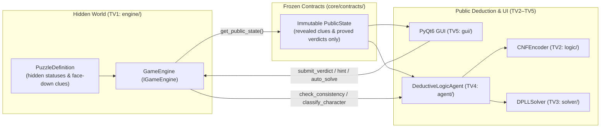

# Griductive Solver — No-Guess Propositional Logic AI

> **CSC14003 — Introduction to Artificial Intelligence (Project 2)**  
> Faculty of Information Technology, University of Science — VNU-HCM

A complete **no-guess Griductive solver** written in Python using **Propositional Logic**, automatic **CNF Encoding** (Direct Combinatorial & Sinz Sequential Counter), a pure-Python **DPLL SAT Solver**, a **Deductive Logic Agent** (entailment via refutation), and an interactive **PyQt6 Desktop GUI**.

---

## Overview

In **Griductive**, every cell on an $N \times N$ grid ($N \in \{3, 4, 5\}$) holds a character who is secretly either a **Criminal** ($C_i = \text{True}$) or **Innocent** ($C_i = \text{False}$), along with a structured clue that is **always true** regardless of the owner's status.

The central invariant is the **No-Guess Rule**: a verdict is accepted **if and only if** it is a **logical consequence (entailment)** of the currently revealed public knowledge base $KB_t$:

$$
KB_t \models C_i \iff (KB_t \wedge \neg C_i)\text{ is UNSAT}, \qquad
KB_t \models \neg C_i \iff (KB_t \wedge C_i)\text{ is UNSAT}
$$

If neither status is forced, the solver returns `UNKNOWN` (`NOT_PROVABLE`) and **never guesses**. If $KB_t$ itself is unsatisfiable, it immediately reports `INCONSISTENT`.

---

## System Architecture

The codebase follows a **Contract-First Layered Modular Architecture (Ports & Adapters)** with strict directory ownership across 5 team members and strict isolation between the **Hidden World** (`GameEngine`) and **Public Knowledge** (`LogicAgent` & `GUI`):



---

## Key Features

- **Strict Hidden-State Isolation (`Source/engine/`):** `PublicState` and `CharacterPublicInfo` are deeply immutable (`frozen` dataclasses + `MappingProxyType`); rejected verdicts (`NOT_PROVABLE`, `CONTRADICTED`, `INCONSISTENT`) never alter game state or leak face-down clues, and `get_highlighted_cells()` returns `[]` for unrevealed cards.
- **Automatic CNF Encoding & Direct Oracle (`Source/logic/`):** Zero hand-written puzzle CNF. Supports all **6 core clue templates** (`FACT`, `SAME`, `DIFFERENT`, `EXACTLY` / `NO`, `AT_LEAST`, `AT_MOST`), **4 core regions** (`ROW`, `COL`, `NEIGHBORS`, `EXPLICIT`), and **3 language extensions**:
  - *Extension 1 — Advanced Region Expressions:* `CORNERS`, `BOUNDARY`, `COMMON_NEIGHBORS`, `BETWEEN`, `INTERSECTION`
  - *Extension 2 — Parity Constraints:* `PARITY` (`EVEN` / `ODD` via Tseitin XOR chain)
  - *Extension 3 — Regional Count Comparison:* `COMPARE_COUNTS` (`EQ`, `LT`, `GT`, `LE`, `GE` via unary thermometer counters)
  - Interchangeable **Direct Combinatorial** vs. **Sinz Sequential Counter** cardinality encodings + an independent `DirectSemanticEvaluator` oracle verified exhaustively across all $2^9 = 512$ 3×3 assignments.
- **Pure-Python DPLL SAT Solver (`Source/solver/`):** Iterative Unit Propagation, early conflict detection, deterministic variable selection (`lexicographic`, `moms`, `jw`), optional Pure-Literal Elimination, non-destructive `assumptions`, DIMACS CNF I/O, and exact metrics (`decisions`, `propagations`, `backtracks`, `runtime_ms`).
- **No-Guess Deductive Logic Agent (`Source/agent/`):** Entailment-based board classification in deterministic row-major order, **Model Caching** + bounded LRU `KBCache` (avoiding double SAT counting during engine validation), full **Deduction Trace**, public-only **Hint Engine**, and primary-variable blocking **Uniqueness Checker**.
- **Interactive PyQt6 Desktop GUI (`Source/gui/`, `Source/main.py`):** Visual $N \times N$ board with row/column coordinates, character names & professions, natural-language clue rendering, interactive clue-region highlighting (`REF`), manual `CRIMINAL`/`INNOCENT` calls with distinct error banners, `Load`, `Restart`, `Hint`, animated `Auto Solve`, live **Deduction Trace** & SAT/CNF stats, and `Uniqueness` verification.
- **15 Mathematically Verified Puzzles (`Source/puzzles/`):** `4 × 3×3`, `4 × 4×4`, `2 × 5×5` (stress cases), `3 × extensions`, and `2 × edge_cases` (`AMBIGUOUS` and `INCONSISTENT`).

---

## Benchmark Highlights

Evaluated headless across **8 ablation configurations (`C0`–`C7`) × 15 puzzles × 3 repeats = 360 runs** (60s timeout per run, real `CNFEncoder` + `DPLLSolver` + `DeductiveLogicAgent`; full details in [docs/report_tv4_experiments.md](docs/report_tv4_experiments.md)):

| Metric (10 Standard Puzzles: 4×3×3, 4×4×4, 2×5×5) | Baseline `C0` (`direct`, `lex`, no cache) | Optimized `C6` (`direct`, `moms`, PL + cache) | Improvement |
| :--- | :---: | :---: | :---: |
| Solved Rate (`SOLVED`, 0 timeouts) | **100%** (10/10) | **100%** (10/10) | 100% reliable |
| Total Real SAT Calls (`sat_calls_total`) | 1,643 | **997** | **-39.32%** |
| Total DPLL Decisions (`total_decisions`) | 693 | **122** | **-82.40%** |
| Total Median Runtime (`total_runtime_ms`) | 163.64 ms | **116.29 ms** | **-28.94%** |
| Determinism & Cross-Config Consistency | `120/120 PASS` | `120/120 PASS` | 100% deterministic |

- Both `5×5` stress cases solve cleanly well under 0.1s (`24.48 ms` and `46.32 ms` median on `C6`).
- On `edge_cases/`, all 8 configurations halt safely at `AMBIGUOUS` (step 3, zero guesses) and immediately detect `INCONSISTENT` (step 0, 1 SAT call).

---

## Quick Start

### 1. Installation

Requires **Python 3.10 – 3.12**.

```bash
git clone https://github.com/LeoTkiet/bloxfruit-prj2.git
cd bloxfruit-prj2

python -m venv .venv

# Windows (PowerShell)
.\.venv\Scripts\Activate.ps1
# macOS / Linux
# source .venv/bin/activate

pip install -r Source/requirements.txt
```

### 2. Launch the Desktop GUI

```bash
python Source/main.py
```

Optional CLI flags (see [Source/README.md](Source/README.md) for full controls & keyboard shortcuts):

```bash
# Launch a 5x5 stress-case puzzle with Sinz encoding and MOMs heuristic
python Source/main.py --puzzle Source/puzzles/5x5/5x5_01_grand_precinct.json --encoding sinz --heuristic moms --strict
```

### 3. Validate the Puzzle Dataset

```bash
# PowerShell
$env:PYTHONPATH="Source"; python -m engine.puzzle_validator Source/puzzles

# Bash
PYTHONPATH=Source python -m engine.puzzle_validator Source/puzzles
```

### 4. Run Automated Tests

```bash
# Run the full test suite (including headless PyQt6 GUI tests)
# PowerShell:
$env:QT_QPA_PLATFORM="offscreen"; pytest

# Bash:
QT_QPA_PLATFORM=offscreen pytest
```

### 5. Run Benchmarks, Uniqueness Check & Plots

```bash
# Verify uniqueness across all 15 puzzles -> Source/experiments/results/uniqueness_report.csv
python Source/experiments/uniqueness_report.py

# Run full C0-C7 benchmark across all 15 puzzles (3 repeats, 60s timeout)
python Source/experiments/benchmark.py --include-extensions --repeats 3 --timeout-s 60 --best-heur moms

# Generate RQ1-RQ4 PNG charts -> Source/experiments/results/charts/
python Source/experiments/plots.py
```

---

## Repository Structure & Team Ownership

```text
bloxfruit-prj2/
├── README.md                              # Project overview & quick start
├── pytest.ini                             # Pytest configuration (pythonpath = Source)
├── LICENSE                                # MIT License
├── Source/
│   ├── main.py                            # [TV5] Entry point & Dependency Injection wiring
│   ├── requirements.txt                   # [TV5] Python dependencies (PyQt6, matplotlib, pytest)
│   ├── README.md                          # [TV5] Detailed run & GUI usage guide
│   ├── core/contracts/                    # [TV1 lead, frozen] Immutable models & Protocol interfaces
│   ├── engine/                            # [TV1] GameEngine, PuzzleLoader, PuzzleValidator
│   ├── puzzles/                           # [TV1] 15 verified JSON puzzles (3x3, 4x4, 5x5, extensions, edge_cases)
│   ├── logic/                             # [TV2] VariableMapper, RegionResolver, CNFEncoder, DirectEvaluator
│   ├── solver/                            # [TV3] Pure-Python DPLLSolver, heuristics (MOMs/JW/PL), DIMACS I/O
│   ├── agent/                             # [TV4] DeductiveLogicAgent, Entailment, KBCache, Hint, Uniqueness
│   ├── experiments/                       # [TV4] Benchmark harness (C0–C7), uniqueness report, RQ1–RQ4 plots
│   ├── gui/                               # [TV5] PyQt6 GUI (main window, board, cards, trace panel, worker)
│   └── tests/                             # Module test suites: test_engine, test_logic, test_solver, test_agent, test_experiments, test_gui
└── docs/                                  # Technical report drafts & design docs per team member
```

### Team Responsibilities

| Member | Primary Role | Owned Modules | Technical Documentation |
| :---: | :--- | :--- | :--- |
| **TV1** | System Architect, Game Engine & Puzzles | `Source/core/contracts/`, `Source/engine/`, `Source/puzzles/` | [Problem Formulation](docs/tv1_problem_formulation.md), [Puzzle Schema](Source/puzzles/README.md) |
| **TV2** | Logic Representation & CNF Encoding | `Source/logic/` | [CNF Encoding & Derivations](docs/tv2_cnf_encoding.md) |
| **TV3** | Pure-Python DPLL SAT Solver | `Source/solver/` | [DPLL SAT Solver](docs/tv3_dpll_solver.md) |
| **TV4** | Deductive Logic Agent & Experiments | `Source/agent/`, `Source/experiments/` | [Agent Algorithms](docs/report_tv4_algorithms.md), [Experiments & Analysis](docs/report_tv4_experiments.md), [Agent Conventions](docs/tv4_agent_conventions.md) |
| **TV5** | PyQt6 GUI, E2E Integration & Demo | `Source/gui/`, `Source/main.py`, `Source/README.md` | [GUI & Integration](docs/tv5_gui_and_integration.md), [Demo Script](docs/tv5_demo_script.md) |

---

## License

This project is licensed under the [MIT License](LICENSE).
