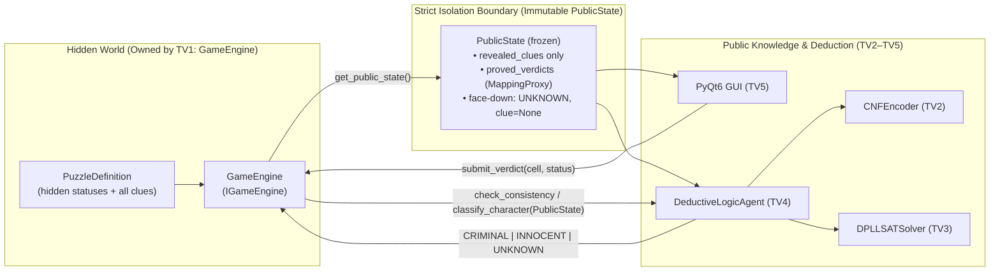

# Section 2: Problem Formulation & System Architecture (TV1 Contribution)

> **Author:** Thành viên 1 (TV1) — Kiến trúc sư hệ thống, Game Engine & Dữ liệu Puzzle  
> **Scope:** Ready-to-merge report section for `Report.pdf` covering Project 2 Spec Section 4.6 (*Problem formulation: variables, clue semantics, Knowledge Base, and the reveal protocol*) and the strict `GameEngine` / `LogicAgent` architectural separation.

---

## 2.1 Board Model & Propositional Variables

A Griductive puzzle is defined on an $N \times N$ square grid ($N \in \{3, 4, 5\}$). Columns are labeled left-to-right by uppercase letters $A, B, \dots$ and rows top-to-bottom by integers $1, 2, \dots, N$; thus cell `C2` denotes column $C$, row $2$. Each cell contains a distinct character with a display name (sorted alphabetically in row-major order `A1, B1, ..., EN`), a profession, a hidden binary status (**Criminal** or **Innocent**), and exactly one structured clue.

For each cell $i \in \{1, \dots, N^2\}$ indexed deterministically in row-major order, we introduce one **primary propositional Boolean variable**:

$$
C_i = \begin{cases}
\text{True}, & \text{if character } i \text{ is a Criminal}, \\
\text{False}, & \text{if character } i \text{ is Innocent}.
\end{cases}
$$

The mapping $\phi : \text{CellID} \to \{1, \dots, N^2\}$ is fixed as $\phi(r, c) = r \cdot N + c + 1$ (0-based row $r$ and column $c$). Any **auxiliary variables** introduced during CNF encoding (e.g., Tseitin variables for `PARITY` XOR chains or Sequential Counter variables for cardinality constraints) are allocated strictly from $N^2 + 1$ upward and kept separate from primary variables $C_1, \dots, C_{N^2}$.

---

## 2.2 Clue Regions & Semantics

Every revealed clue is **guaranteed to be true** regardless of whether its owner is a Criminal or an Innocent.

### Core Regions (4 Required)
1. **`ROW(r)`**: $\{ (r, c) \mid 0 \le c < N \}$ — all cells in row $r$.
2. **`COL(c)`**: $\{ (r, c) \mid 0 \le r < N \}$ — all cells in column $c$.
3. **`NEIGHBORS(u)`**: all cells touching $u$ horizontally, vertically, or diagonally, excluding $u$ itself (up to 8 cells for interior, 5 for edge, 3 for corner).
4. **`EXPLICIT(L)`**: a specified non-empty set of distinct cell identifiers $L \subseteq \text{Grid}$.

### Core Clue Templates (6 Required)

| Clue Template | Parameters | Logical Semantics (over complete assignment $\alpha$) |
| :--- | :--- | :--- |
| `FACT` | $i$, status $s \in \{\text{CRIMINAL}, \text{INNOCENT}\}$ | $C_i$ if $s = \text{CRIMINAL}$, else $\neg C_i$ |
| `SAME` | distinct $i, j$ | $C_i \leftrightarrow C_j$ |
| `DIFFERENT` | distinct $i, j$ | $C_i \oplus C_j$ |
| `EXACTLY` | region $R$, integer $0 \le k \le |R|$ | $\sum_{i \in R} \mathbb{I}[\alpha(C_i)] = k$ (keyword `NO` normalizes to `EXACTLY(0, R)`) |
| `AT_LEAST` | region $R$, integer $0 \le k \le |R|$ | $\sum_{i \in R} \mathbb{I}[\alpha(C_i)] \ge k$ |
| `AT_MOST` | region $R$, integer $0 \le k \le |R|$ | $\sum_{i \in R} \mathbb{I}[\alpha(C_i)] \le k$ |

### Implemented Language Extensions ($\ge 2$ Distinct Extensions)
- **Extension 1 — Advanced Region Expressions**:
  - `CORNERS`: the 4 corner cells $\{A1, \dots, EN\}$.
  - `BOUNDARY`: all outer perimeter cells where $r \in \{0, N-1\}$ or $c \in \{0, N-1\}$.
  - `COMMON_NEIGHBORS(u, v)`: $\text{NEIGHBORS}(u) \cap \text{NEIGHBORS}(v)$.
  - `BETWEEN(u, v)`: all cells strictly between $u$ and $v$ sharing the same row or column.
  - `INTERSECTION(R_1, ..., R_m)`: $\bigcap_{j=1}^m R_j$.
- **Extension 2 — Parity Constraint (`PARITY`)**:
  - `PARITY(R, EVEN)`: $\sum_{i \in R} \mathbb{I}[\alpha(C_i)] \equiv 0 \pmod 2$.
  - `PARITY(R, ODD)`: $\sum_{i \in R} \mathbb{I}[\alpha(C_i)] \equiv 1 \pmod 2$.
- **Extension 3 (Bonus) — Regional Count Comparison (`COMPARE_COUNTS`)**:
  - `COMPARE_COUNTS(R_1, R_2, op)` with $\text{op} \in \{=, <, >, \le, \ge\}$: $\sum_{i \in R_1} C_i \;\text{op}\; \sum_{j \in R_2} C_j$.

---

## 2.3 Dynamic Knowledge Base ($KB_t$) & Entailment

At deduction step $t \ge 0$, let $V_t \subseteq \text{Grid}$ denote the set of currently revealed (face-up) cards. Each card $v \in V_t$ contributes its proved verdict $s_v \in \{\text{CRIMINAL}, \text{INNOCENT}\}$ and its revealed structured clue $\psi_v$. The public knowledge base is compiled automatically into CNF as:

$$
KB_t \;=\; \left( \bigwedge_{v \in V_t} \text{CNF}(\psi_v) \right) \;\wedge\; \left( \bigwedge_{v \in V_t} \ell(v, s_v) \right)
$$

where $\ell(v, \text{CRIMINAL}) = C_v$ and $\ell(v, \text{INNOCENT}) = \neg C_v$. Unrevealed clues ($\psi_u$ for $u \notin V_t$) and hidden statuses **never** appear in $KB_t$.

Under the **No-Guess Rule**, a verdict on an unsolved character $i \notin V_t$ is valid if and only if it is logically entailed by $KB_t$ (true in *every* model of $KB_t$):

- If $KB_t$ is UNSAT $\implies$ **`INCONSISTENT`**.
- If $KB_t \wedge \neg C_i$ is UNSAT $\implies KB_t \models C_i \implies$ **`CRIMINAL`**.
- If $KB_t \wedge C_i$ is UNSAT $\implies KB_t \models \neg C_i \implies$ **`INNOCENT`**.
- If both $KB_t \wedge \neg C_i$ and $KB_t \wedge C_i$ are SAT $\implies$ **`UNKNOWN`** (must NOT guess).

A valid puzzle's complete clue set $\{\psi_u\}_{u \in \text{Grid}}$ must admit **exactly one** complete assignment (verified via blocking-clause uniqueness checking).

---

## 2.4 Reveal Protocol & Strict `GameEngine` / `LogicAgent` Isolation

To guarantee that neither manual play nor automated deduction can ever peek at hidden labels or face-down clues, the system enforces a strict **Contract-First Ports & Adapters** boundary (`Source/core/contracts/`):

### Safe Verdict & Reveal Protocol (`submit_verdict(cell, status)`)
1. `GameEngine` constructs a fresh deeply immutable `PublicState` snapshot (all face-down cards enforced at runtime in `CharacterPublicInfo.__post_init__` to have `status = UNKNOWN` and `clue = None`).
2. `GameEngine` queries the injected `ILogicAgent` using **only** `PublicState`:
   - If `check_consistency(PublicState)` is `False` $\to$ return `VerdictCode.INCONSISTENT`, state unchanged.
   - Compute `entailed = classify_character(PublicState, cell)`:
     - `entailed == UNKNOWN` $\to$ return `VerdictCode.NOT_PROVABLE`, `revealed_clue = None`, state unchanged.
     - `entailed != status` $\to$ return `VerdictCode.CONTRADICTED`, `revealed_clue = None`, state unchanged.
     - `entailed == status` $\to$ accept verdict, flip card (`V_{t+1} = V_t \cup \{cell\}`), reveal its clue, increment $t \leftarrow t+1$, and return `VerdictCode.ACCEPTED` with the updated `PublicState`.
3. Clue highlighting (`get_highlighted_cells(cell)`) returns `[]` whenever `cell` is face-down, preventing indirect leakage of hidden clue targets.

---

## 2.5 Puzzle Dataset Overview (`Source/puzzles/`)

TV1 designed a standardized JSON puzzle schema (`Source/puzzles/README.md`), CLI validator (`python -m engine.puzzle_validator`), and a verified suite of **15 puzzles**:

- **4 × `3x3` puzzles** (`easy` → `hard`) covering all 6 core templates and 4 core regions.
- **4 × `4x4` puzzles** (`medium` → `hard`) requiring multi-wave deductions.
- **2 × `5x5` stress-case puzzles** (25 characters each) designed for scalability benchmarks.
- **3 × Extension puzzles** (`3x3` and `4x4`) exercising Advanced Regions (`CORNERS`, `BOUNDARY`, `COMMON_NEIGHBORS`, `BETWEEN`, `INTERSECTION`), `PARITY` (`EVEN`/`ODD`), and `COMPARE_COUNTS`.
- **2 × Edge-case puzzles** (`edge_3x3_01_ambiguous.json` testing no-guess halting on symmetry, and `edge_3x3_02_inconsistent.json` testing immediate `INCONSISTENT` detection on UNSAT $KB_0$).
