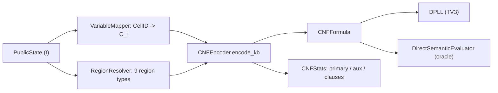

# Mục 3 & 4.2: Biểu diễn Logic, Phân giải Vùng & Mã hóa CNF (TV2 Contribution)

> **Tác giả:** Thành viên 2 (TV2) — Kỹ sư Biểu diễn Logic, Phân giải Vùng & Bộ mã hóa CNF  
> **Phạm vi:** Bản thảo sẵn sàng ghép vào `Report.pdf` theo yêu cầu 3.1–3.3 & 4.2 (*variables, clue semantics, KB, CNF encoding derivations, direct evaluator*).  
> **Mã nguồn:** `Source/logic/{variable_mapper,region_resolver,cnf_encoder,evaluator}.py`

---

## 3.1 Biến mệnh đề và ánh xạ tất định

Với mỗi nhân vật trên bàn $N \times N$, hệ thống định nghĩa **đúng một biến mệnh đề chính** $C_i$:

$$
C_i = \begin{cases}
\text{True}, & \text{nhân vật } i \text{ là Tội phạm (Criminal)},\\
\text{False}, & \text{nhân vật } i \text{ là Người vô tội (Innocent)}.
\end{cases}
$$

Ánh xạ tọa độ ô $\to$ chỉ số biến được cố định theo thứ tự **row-major** (duyệt hàng trên xuống, trong mỗi hàng từ trái sang phải):

$$
\operatorname{var}(r,c) = r \cdot N + c + 1, \qquad 0 \le r,c < N
$$

Ví dụ với $N=3$: `A1 → 1`, `B1 → 2`, `C1 → 3`, `A2 → 4`, …, `C3 → 9`. Với $N=5$: `E5 → 25`.

Tính tất định này được đảm bảo bởi `VariableMapper` / hàm `cell_to_var()` và hàm ngược `var_to_cell()`. Mọi danh sách ô do bộ phân giải vùng trả về đều được **sắp xếp lại theo cùng thứ tự row-major**, giúp công thức CNF sinh ra không đổi giữa các lần chạy (deterministic encoding).

**Biến phụ (auxiliary variables).** Các biến phát sinh trong mã hóa (Tseitin cho PARITY, bộ đếm Sinz, bộ đếm unary cho COMPARE_COUNTS) được cấp phát bởi `AuxVarAllocator` bắt đầu từ $N^2 + 1$ và **không bao giờ** trùng với tập biến chính $C_1, \dots, C_{N^2}$. Trong một lượt `encode_kb`, một allocator duy nhất được dùng chung cho toàn bộ manh mối nên chỉ số biến phụ là toàn cục, không bị trùng giữa các clue.

---

## 3.2 Ngôn ngữ manh mối & phân giải vùng

`RegionResolver` chuyển mô tả vùng thành tập ô cụ thể, kiểm tra tham số và loại bỏ trùng lặp. Tổng cộng **9 loại vùng** được hỗ trợ:

| Loại vùng | Tham số | Tập ô kết quả |
|---|---|---|
| `ROW` | `row = r` | Tất cả ô có cùng số hàng $r$ ($N$ ô) |
| `COL` | `col = 'C'` | Tất cả ô có cùng chữ cái cột ($N$ ô) |
| `NEIGHBORS` | `center` | 8 ô kề ngang/dọc/chéo, **loại trừ chính ô đó** (giữa 8, cạnh 5, góc 3) |
| `EXPLICIT` | `cells = [...]` | Danh sách ô tường minh, phải khác nhau và nằm trong biên |
| `INTERSECTION` | `sub_regions` | Giao của $\ge 2$ vùng con (đệ quy) |
| `COMMON_NEIGHBORS` | đúng 2 ô | Giao tập láng giềng của hai ô |
| `CORNERS` | — | 4 ô góc của bàn |
| `BOUNDARY` | — | Toàn bộ viền ngoài ($4N-4$ ô) |
| `BETWEEN` | đúng 2 ô cùng hàng/cột | Các ô nằm **giữa** hai đầu mút (có thể rỗng nếu kề nhau) |

Các kiểm tra hợp lệ: $1 \le \text{row} \le N$, chữ cái cột hợp lệ và nằm trong bàn, mọi CellID phải tồn tại trong bàn, `EXPLICIT` không được rỗng/trùng, `COMMON_NEIGHBORS`/`BETWEEN` nhận đúng 2 ô phân biệt, `INTERSECTION` nhận $\ge 2$ vùng con, và với manh mối đếm $0 \le k \le |R|$.

Bộ phân giải của TV2 được cài đặt **độc lập** với `engine/` (Strict Directory Ownership), nhưng kiểm thử đối chiếu chéo với `engine.puzzle_validator.resolve_region_cells` trên **toàn bộ vùng của 15 màn chơi** để đảm bảo highlight (TV1/TV5) và encoder (TV2) luôn thấy cùng một tập ô.

---

## 3.3 Dẫn xuất mã hóa CNF

Mọi manh mối được biên dịch tự động thành các clause $\bigvee l_j$; không có công thức nào được viết tay riêng cho một puzzle.

### 3.3.1 `FACT` — mệnh đề đơn vị

Manh mối “$X$ là Tội phạm” cho clause $[C_X]$; “$X$ vô tội” cho clause $[-C_X]$.

### 3.3.2 `SAME` — dẫn xuất nhị phân

$$
C_i \leftrightarrow C_j \equiv (\neg C_i \lor C_j) \land (C_i \lor \neg C_j)
$$

**Chứng minh bằng bảng chân trị rút gọn:**

| $C_i$ | $C_j$ | $C_i \leftrightarrow C_j$ | $(\neg C_i \lor C_j)$ | $(C_i \lor \neg C_j)$ |
|:---:|:---:|:---:|:---:|:---:|
| T | T | T | T | T |
| T | F | F | F | T |
| F | T | F | T | F |
| F | F | T | T | T |

Hai clause CNF [`-v_i, v_j`] và [`v_i, -v_j`] triệt tiêu đúng hai hàng sai của tích, nên tương đương logic.

### 3.3.3 `DIFFERENT` — dẫn xuất nhị phân

$$
C_i \oplus C_j \equiv (C_i \lor C_j) \land (\neg C_i \lor \neg C_j)
$$

Hai clause [`v_i, v_j`] và [`-v_i, -v_j`] lần lượt cấm $(F,F)$ và $(T,T)$, giữ lại đúng các trường hợp khác nhau.

### 3.3.4 `EXACTLY` / `AT_LEAST` / `AT_MOST` — mệnh đề đếm

Gọi $R = \{i_1, \dots, i_m\}$ là vùng đã phân giải và $l_t = C_{i_t}$. Ta cần mã hóa $\sum_{t=1}^{m} l_t = k$ (hoặc $\ge k$, $\le k$).

$$
\text{EXACTLY}(k,R) \equiv \text{AT\_LEAST}(k,R) \land \text{AT\_MOST}(k,R)
$$

**Chiến lược 1 — Mã hóa tổ hợp trực tiếp (direct), không biến phụ:**

$$
\text{AT\_MOST}(k,R) = \bigwedge_{S \subseteq R,\; |S| = k+1} \left(\bigvee_{i \in S} \neg C_i\right)
$$

*Đúng đắn:* nếu có $k+1$ biến mang giá trị True thì tồn tại tập con $S$ kích thước $k+1$ gồm toàn literal dương, clause tương ứng vô hiệu → công thức sai.  
*Đầy đủ:* nếu không có tập con như vậy thì số True tối đa là $k$, mọi clause đều có ít nhất một literal âm True → công thức đúng.

Tương tự, dùng $m-k$ biến phủ định:

$$
\text{AT\_LEAST}(k,R) = \bigwedge_{S \subseteq R,\; |S| = m-k+1} \left(\bigvee_{i \in S} C_i\right)
$$

Số clause tương ứng là $\binom{m}{k+1}$ và $\binom{m}{m-k+1}$. Với các vùng nhỏ của trò chơi ($m \le 8$), chiến lược này rất gọn. Ví dụ $\text{EXACTLY}(1,\{A1,B1,C1\})$ sinh 1 clause `[1,2,3]` và 3 clause `[-1,-2]`, `[-1,-3]`, `[-2,-3]`.

Trường hợp biên: $k=0 \Rightarrow \bigwedge_t [-l_t]$ (không Tội phạm — tương đương từ khóa `NO`); $k \ge m$ hoặc $k \le 0$ tương ứng công thức đúng, không sinh clause.

**Chiến lược 2 — Bộ đếm tuần tự Sinz (sinz), dùng $O(mk)$ biến phụ:**

Đặt $s_{i,j} \leftrightarrow \big(\sum_{t \le i} l_t \ge j+1\big)$ với $0 \le i \le m-2$, $0 \le j \le k-1$. Các clause:

$$
\begin{aligned}
&(\neg l_1 \lor s_{0,1}), \quad (\neg s_{0,j}) \;\; (2 \le j \le k),\\
&(\neg l_i \lor s_{i,1}), \quad (\neg s_{i-1,1} \lor s_{i,1}),\\
&(\neg l_i \lor \neg s_{i-1,j-1} \lor s_{i,j}), \quad (\neg s_{i-1,j} \lor s_{i,j}) \;\; (2 \le j \le k),\\
&(\neg l_i \lor \neg s_{i-1,k}) \;\; (2 \le i \le m-1),\\
&(\neg l_m \lor \neg s_{m-1,k}).
\end{aligned}
$$

Bất đẳng thức $\text{AT\_LEAST}(k,R)$ được mã hóa bằng cách áp dụng bộ đếm trên cho $\neg l_t$ với ngưỡng $m-k$. Hai chiến lược được chọn qua `CNFEncoder(cardinality_encoding="direct"|"sinz")` để phục vụ thí nghiệm so sánh ở mục 4.5.

### 3.3.5 `PARITY` — Extension 1 (Tseitin XOR)

Cần $\left(\bigoplus_{t=1}^{m} l_t\right) = p$ với $p=1$ (ODD) hoặc $p=0$ (EVEN). Với $m \ge 3$, dùng biến tích lũy $a_1 = l_1$, sau đó với mỗi $t = 2,\dots,m-1$ cấp phát biến Tseitin $a_t \leftrightarrow (a_{t-1} \oplus l_t)$:

$$
\begin{aligned}
(\neg a \lor \neg l \lor \neg o) &\land (a \lor l \lor \neg o)\\
(\neg a \lor l \lor o) &\land (a \lor \neg l \lor o)
\end{aligned}
$$

Cuối cùng ràng buộc $a_{m-1} \oplus l_m = p$ bằng hai clause [`a, l_m`], [`-a, -l_m`] nếu ODD, hoặc [`-a, l_m`], [`a, -l_m`] nếu EVEN. Với $m=1$ dùng một clause đơn vị; $m=0$ trả về clause rỗng khi ODD (UNSAT) và không clause khi EVEN.

### 3.3.6 `COMPARE_COUNTS` — Extension 2

Để so sánh $|R_A|$ và $|R_B|$, TV2 dựng **bộ đếm nhiệt kế chính xác** $g_t \leftrightarrow (\sum_{s \le t} l_s \ge j)$ cho mỗi vùng (dùng biến phụ), rồi dùng:

$$
\begin{aligned}
\text{count}(A) \le \text{count}(B) &: \bigwedge_t (\neg a_t \lor b_t),\\
\text{count}(A) < \text{count}(B) &: b_1 \land \bigwedge_t (\neg a_t \lor b_{t+1}).
\end{aligned}
$$

`EQ` = $\le$ cả hai chiều; `GE`/`GT` đổi vai trò $A,B$. Các toán tử `EQ`, `LT`, `GT`, `LE`, `GE` đều được hỗ trợ và kiểm chứng bằng oracle.

---

## 3.4 KB_t và thống kê

Tại bước suy diễn $t$:

$$
KB_t = \text{CNF}(\text{revealed clues}) \land \bigwedge_{v \in \text{proved}} \text{unit}(v)
$$

`CNFEncoder.encode_kb(public_state)` chỉ đọc `PublicState` — tức là **chỉ** các thẻ đã ngửa và các phán quyết đã chứng minh. Trạng thái ẩn và manh mối chưa lật không bao giờ xuất hiện trong $KB_t$.

Hàm trả về cặp `(CNFFormula, CNFStats)` với:

- `num_primary_vars = N²`,
- `num_aux_vars` = số biến phụ thực sự cấp phát,
- `num_clauses` = tổng số clause sinh ra,
- `encoding_strategy = "direct" | "sinz"`.

`CNFFormula` còn kèm ánh xạ `cell_to_var` / `var_to_cell` (bọc `MappingProxyType`) để TV4 chuyển kết quả SAT model sang nhãn nhân vật.



---

## 3.5 Bộ đánh giá ngữ nghĩa trực tiếp & kiểm chứng tương đương

`DirectSemanticEvaluator.evaluate_clue_direct(clue, assignment, grid_size)` nhận **phép gán đầy đủ** $\{C_i\}_{i=1}^{N^2}$ và tính trực tiếp đúng/sai của từng clue **không gọi CNF encoder, không gọi SAT solver**:

- `FACT`: so sánh giá trị biến với `target_status`;
- `SAME`/`DIFFERENT`: so sánh hai giá trị;
- các clue đếm: đếm số True trong vùng đã phân giải rồi so với $k$;
- `PARITY`: kiểm tra $k \bmod 2$;
- `COMPARE_COUNTS`: so sánh hai số lượng đếm được theo toán tử.

**Phương pháp kiểm chứng 100%:** với mỗi clue (6 mẫu cốt lõi + các extension, cả từ các file puzzle lẫn clue crafted) và mỗi chiến lược mã hóa, duyệt **toàn bộ $2^9 = 512$ phép gán** của lưới 3×3. Với mỗi phép gán, ta cố định các biến chính trong CNF và cho phép tồn tại hóa các biến phụ bằng một bộ kiểm tra clause nhỏ độc lập với TV3. Kết quả phải khớp hoàn toàn với `DirectSemanticEvaluator`. Ngoài ra, 12 phép gán mẫu (seed cố định) được kiểm tra cho mọi clue 4×4 và 5×5.

---

## 3.6 Tích hợp

```python
from logic import CNFEncoder, DirectSemanticEvaluator

encoder = CNFEncoder(cardinality_encoding="direct")
cnf, stats = encoder.encode_kb(public_state)      # TV4 dùng cnf cho entailment
ok = DirectSemanticEvaluator().evaluate_clue_direct(clue, assignment, 3)
```

Class được export ngay tại `logic` root nên `experiments.encoder_factory` của TV4 tự động nhận diện encoder thật (không rơi về stub) cho cả hai chế độ `direct` và `sinz`.
