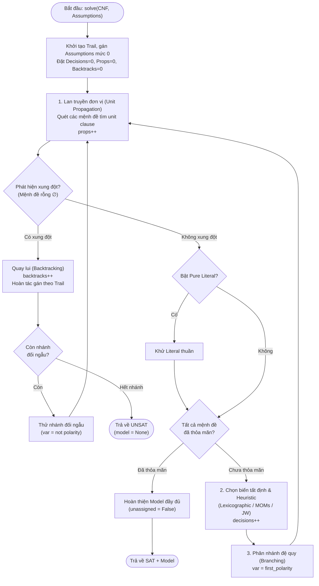

# Section 4: Thuật toán DPLL SAT Solver & Tối ưu hóa (TV3 Contribution)

> **Author:** Thành viên 3 (TV3) — Kỹ sư Thuật toán DPLL SAT Solver & Tối ưu  
> **Scope:** Bản thảo hoàn chỉnh sẵn sàng ghép vào `Report.pdf` theo Yêu cầu 4.3 & 4.6 (*DPLL algorithm, pseudocode, unit propagation, conflict detection, branching heuristics, assumptions handling, and complexity analysis*).

---

## 4.1 Đặt bài toán Thỏa mãn Mệnh đề (Boolean Satisfiability - SAT)

Bài toán SAT nhận đầu vào là một công thức logic mệnh đề ở dạng chuẩn hội (**Conjunctive Normal Form - CNF**):

$$\Phi = \bigwedge_{j=1}^m C_j = \bigwedge_{j=1}^m \left( \bigvee_{l \in C_j} l \right)$$

trong đó mỗi literal $l$ là một biến mệnh đề $x_i$ hoặc phủ định $\neg x_i$ ($i \in \{1, \dots, n\}$). Mục tiêu của bộ giải SAT là xác định xem tồn tại một phép gán chân trị $\alpha : \{1, \dots, n\} \to \{\text{True}, \text{False}\}$ sao cho $\Phi$ nhận giá trị $\text{True}$ hay không. Nếu tồn tại, trả về **SAT** kèm một nghiệm hoàn chỉnh $\alpha$; ngược lại chứng minh không tồn tại phép gán nào và kết luận **UNSAT**.

Trong đồ án Griductive, bộ giải SAT đóng vai trò hạt nhân suy luận cho Tác tử Logic (TV4): mọi truy vấn kiểm tra hệ quả logic (**Entailment**) để xác định một nhân vật là Tội phạm hay Vô tộc đều được chuyển thành một chuỗi các bài toán phản chứng SAT:

$$KB_t \models C_i \iff KB_t \wedge \neg C_i \text{ là UNSAT}$$
$$KB_t \models \neg C_i \iff KB_t \wedge C_i \text{ là UNSAT}$$

---

## 4.2 Kiến trúc Thuật toán DPLL (Davis-Putnam-Logemann-Loveland)

Bộ giải `DPLLSolver` trong `Source/solver/dpll_solver.py` được tự cài đặt hoàn toàn bằng **Python thuần** (không dùng thư viện ngoài như PySAT hay Z3), đáp ứng trọn vẹn 6 yêu cầu kỹ thuật cốt lõi:



### 1. Lan truyền đơn vị (Unit Propagation)
Nếu một mệnh đề $C \in \Phi$ chỉ còn duy nhất 1 literal $l$ chưa gán giá trị và tất cả các literal còn lại trong $C$ đều mang giá trị $\text{False}$, thì để thỏa mãn $C$, literal $l$ **bắt buộc** phải nhận giá trị $\text{True}$.
- **Tối ưu hóa đa đơn vị trong một lượt (Pass-based Scanning):** Thay vì dừng và quét lại từ đầu ngay khi bắt gặp 1 literal đơn vị (gây chi phí $\mathcal{O}(\#\text{unit} \cdot |F|)$), bộ giải quét trọn vẹn tập mệnh đề trong mỗi lượt, gán tất cả các mệnh đề đơn vị phát hiện được và chỉ lặp lại khi có ít nhất một gán nhãn mới sinh ra. Cơ chế này giảm số vòng lặp lớn xuống chỉ còn 1–2 lượt quét thực tế.
- Mỗi lần gán cưỡng bức từ mệnh đề đơn vị được ghi nhận tăng biến đếm `propagations += 1`.
- Nếu xuất hiện một mệnh đề có tất cả literal đều mang giá trị $\text{False}$ (mệnh đề rỗng $\emptyset$), phát hiện xung đột lập tức.

### 2. Phát hiện xung đột (Conflict Detection)
Khi một phép gán dẫn đến mệnh đề rỗng (không thể thỏa mãn), nhánh tìm kiếm hiện tại lập tức dừng lại sớm mà không duyệt tiếp. Biến đếm `backtracks += 1` được cập nhật, và bộ giải thực hiện quay lui (**backtrack**) bằng cách rút gọn mảng nhật ký (`_trail`) về mốc rẽ nhánh trước đó.

### 3. Phân nhánh Đệ quy & Quay lui (Recursive Branching & Backtracking)
Nếu không còn mệnh đề đơn vị và công thức chưa thỏa mãn, một biến chưa gán $v$ được chọn để phân nhánh:
1. Thử nhánh $v = \text{polarity}$ (`decisions += 1`). Gọi đệ quy `_dpll()`.
2. Nếu nhánh 1 dẫn đến mâu thuẫn (trả về `False`), hoàn tác toàn bộ các gán nhãn phát sinh trong nhánh 1 bằng `_undo_to(branch_mark)`.
3. Thử nhánh đối ngẫu $v = \neg \text{polarity}$. Gọi đệ quy `_dpll()`.
4. Nếu cả 2 nhánh đều thất bại, hoàn tác về trạng thái trước đó và trả về `False` để quay lui lên nút cha.

### 4. Kết quả Chuẩn hóa & Nghiệm Hoàn chỉnh
Khi tất cả các mệnh đề trong công thức đều đã nhận giá trị $\text{True}$, bộ giải đạt trạng thái **SAT**. Mọi biến tự do chưa được gán giá trị (gồm cả biến chính và biến phụ do bộ mã hóa sinh ra) được tự động gán giá trị mặc định $\text{False}$ một cách tất định để trả về một **phép gán hoàn chỉnh** (complete model):

$$\alpha : \{1, \dots, N^2 + n_{\text{aux}}\} \to \{\text{True}, \text{False}\}$$

Ngược lại, nếu toàn bộ cây tìm kiếm bị triệt tiêu, trả về $\text{is\_sat} = \text{False}$ và $\text{model} = \text{None}$.

---

## 4.3 Xử lý Giả thiết Tạm thời (Assumptions Handling) & Caching

Để phục vụ kiểm tra Entailment của Logic Agent, bộ giải hỗ trợ tham số `assumptions: Sequence[int] = ()` trực tiếp trong phương thức:

```python
def solve(self, cnf: CNFFormula, assumptions: Sequence[int] = ()) -> SATResult
```

### Cơ chế hoạt động an toàn & tối ưu:
- **Kiểm tra chặt chẽ đầu vào:** Literal 0 không hợp lệ trong logic mệnh đề; solver chủ động kiểm tra và báo lỗi `ValueError` nếu gặp literal 0 trong mệnh đề hoặc assumptions.
- **Không sao chép hay biến đổi công thức gốc:** Các literal trong `assumptions` được áp dụng trực tiếp vào mảng trạng thái `_assignment` tại mức quyết định 0.
- **Phát hiện mâu thuẫn sớm:** Nếu danh sách assumptions chứa cặp literal đối ngẫu (ví dụ $[C_i, \neg C_i]$), solver trả về `UNSAT` với `backtracks = 1`. Xung đột giữa assumption với các mệnh đề có sẵn trong công thức sẽ được phát hiện ngay trong lượt lan truyền đơn vị đầu tiên với chi phí $\mathcal{O}(|F|)$.
- **Bộ đệm tiền xử lý (Cleaned Clauses Cache):** Khi Logic Agent gọi liên tiếp hàng chục truy vấn `solve()` trên cùng một thực thể `CNFFormula`, bước loại bỏ trùng lặp và mệnh đề hằng đúng (tautology) được cache lại theo `id(cnf.clauses)`, tiết kiệm chi phí CPU đáng kể khi giải các bảng $4\times4$ và $5\times5$.

---

## 4.4 Các Heuristic Chọn Biến & Tối ưu hóa (solver/heuristics.py)

Bộ giải cung cấp lớp cấu hình `DPLLConfig` hỗ trợ 3 chiến lược chọn biến và 1 kỹ thuật khử literal:

### 1. Heuristic Từ điển (Lexicographic - Mặc định)
Chọn biến có chỉ số nhỏ nhất $v = \min(\{ u \in \text{Unassigned} \})$.
- **Đặc điểm:** Hoàn toàn tất định, chi phí tính toán $\mathcal{O}(n)$ cho mỗi lần quét tìm chỉ số nhỏ nhất, rất phù hợp làm baseline đối chuẩn thực nghiệm.
- **Thứ tự phân nhánh:** Tuân thủ `default_polarity` (mặc định $\text{True}$ trước, $\text{False}$ sau).

### 2. Heuristic MOMs (Maximum Occurrences in clauses of Minimum Size)
Ưu tiên chọn biến xuất hiện nhiều nhất trong các mệnh đề chưa thỏa mãn có kích thước nhỏ nhất hiện tại:
1. Xác định kích thước nhỏ nhất $k = \min_{C \in \text{Unresolved}} |C_{\text{active}}|$.
2. Đếm số lần xuất hiện dương $pos[v]$ và âm $neg[v]$ của mỗi biến trong các mệnh đề kích cỡ $k$.
3. Điểm số đánh giá theo biến thể công thức Freeman có hệ số điều chỉnh thích ứng theo độ dài mệnh đề ngắn nhất:
   
   $$\text{Score}(v) = (pos[v] + neg[v]) \cdot 2^k + pos[v] \cdot neg[v]$$

4. Phá hòa (tie-break) tất định bằng chỉ số biến nhỏ nhất. Phân nhánh trước trên literal có số lần xuất hiện lớn hơn; nếu $pos[v] = neg[v]$ thì tuân theo `default_polarity`.

### 3. Heuristic Jeroslow-Wang 2-Sided (JW)
Tính trọng số hàm mũ nghịch đảo theo độ dài mệnh đề cho từng literal $l$ (sử dụng bảng `_POW2` tính sẵn để tăng tốc):

$$J(l) = \sum_{C \in \text{Unresolved}, \, l \in C} 2^{-|C_{\text{active}}|}$$

Điểm số của biến $v$: $\text{Score}(v) = J(v) + J(\neg v)$. Biến có điểm cao nhất được chọn; nhánh ưu tiên thử trước là $\text{arg}\max(J(v), J(\neg v))$.

### 4. Khử Literal thuần (Pure-Literal Elimination)
Nếu một biến chỉ xuất hiện với một cực tính (chỉ dương hoặc chỉ âm) trong tất cả các mệnh đề chưa thỏa mãn, literal đó có thể được gán giá trị chân lý để thỏa mãn toàn bộ các mệnh đề chứa nó mà không làm mất tính thỏa mãn của công thức.

---

## 4.5 Mã giả Thuật toán DPLL

```text
Algorithm DPLL(Clauses, Assignment, Assumptions, Config):
    Input:  Tập mệnh đề CNF Φ, danh sách giả thiết Assumptions, cấu hình Heuristic
    Output: (is_sat, model, metrics)

    Gán tất cả literal trong Assumptions vào Assignment
    Nếu Assumptions tự mâu thuẫn:
        metrics.backtracks ← 1
        Return (False, None, metrics)

    Procedure RecursiveDPLL():
        // 1. Lan truyền đơn vị theo lượt quét toàn cục
        Loop:
            UnitFound ← False
            For each C ∈ Φ:
                If C đã thỏa mãn: Continue
                If C là mệnh đề rỗng (mọi literal đều False):
                    metrics.backtracks ← metrics.backtracks + 1
                    Return False
                If C là mệnh đề đơn vị có literal duy nhất l chưa gán:
                    Assign(var(l), value(l))
                    metrics.propagations ← metrics.propagations + 1
                    UnitFound ← True
            If not UnitFound:
                Break Loop

        // 2. Khử Literal thuần (nếu bật)
        If Config.enable_pure_literal:
            For each l thuần trong các mệnh đề chưa thỏa mãn:
                Assign(var(l), value(l))

        // 3. Kiểm tra điều kiện dừng
        If mọi mệnh đề trong Φ đều đã thỏa mãn:
            Return True
        If không còn biến tự do:
            Return True

        // 4. Chọn biến phân nhánh theo Heuristic
        (var, branch_val) ← SelectVariable(UnassignedVars, Φ, Config)
        metrics.decisions ← metrics.decisions + 1

        // 5. Phân nhánh & Quay lui
        SaveTrailMark()
        Assign(var, branch_val)
        If RecursiveDPLL() == True:
            Return True
        UndoToTrailMark()

        Assign(var, ¬branch_val)
        If RecursiveDPLL() == True:
            Return True
        UndoToTrailMark()

        Return False

    If RecursiveDPLL() == True:
        Hoàn thiện Model cho tất cả các biến tự do còn lại với giá trị False
        Return (True, CompleteModel, metrics)
    Else:
        Return (False, None, metrics)
```

---

## 4.6 Phân tích Độ phức tạp Thời gian & Không gian

| Yếu tố | Độ phức tạp | Phân tích chi tiết |
| :--- | :--- | :--- |
| **Thời gian xấu nhất (Worst-Case Time)** | $\mathcal{O}(2^n \cdot |F|)$ | Với $n$ biến và $|F|$ mệnh đề, cây tìm kiếm nhị phân có tối đa $2^n$ lá. Tại mỗi nút duyệt, lan truyền đơn vị kiểm tra các mệnh đề trong $|F|$. |
| **Không gian bộ nhớ (Space Complexity)** | $\mathcal{O}(n + |F|)$ | Mảng gán nhãn `_assignment` và nhật ký `_trail` chiếm $\mathcal{O}(n)$; tập mệnh đề đã làm sạch `_clauses` chiếm $\mathcal{O}(|F|)$. Độ sâu đệ quy tối đa không vượt quá $n$. |

---

## 4.7 Hướng dẫn Thực nghiệm & Đối sánh cho TV4 (Benchmark Guide)

Để phục vụ Mục 4.5 (*Experiments*) trong Báo cáo cuối kỳ, TV4 có thể sử dụng trực tiếp các cấu hình sau của `DPLLSolver` trong `experiments/benchmark.py`:

```python
from solver.dpll_solver import DPLLSolver
from solver.heuristics import DPLLConfig

# Cấu hình 1: DPLL cơ bản (Baseline)
solver_basic = DPLLSolver(DPLLConfig(heuristic="lexicographic", enable_pure_literal=False))

# Cấu hình 2: DPLL tối ưu với MOMs
solver_moms = DPLLSolver(DPLLConfig(heuristic="moms", enable_pure_literal=False))

# Cấu hình 3: DPLL tối ưu với Jeroslow-Wang + Pure Literal Elimination
solver_jw_pure = DPLLSolver(DPLLConfig(heuristic="jw", enable_pure_literal=True))
```

Mỗi lần gọi `solver.solve(...)` trả về đối tượng `SATMetrics` chứa đầy đủ 4 chỉ số:
- `metrics.decisions`: Số lần rẽ nhánh quyết định.
- `metrics.propagations`: Số lần lan truyền đơn vị cưỡng bức.
- `metrics.backtracks`: Số lần xung đột và quay lui.
- `metrics.runtime_ms`: Thời gian thực thi đo bằng `time.perf_counter()` (ms, unrounded float).
